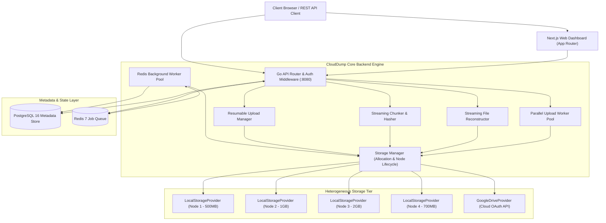
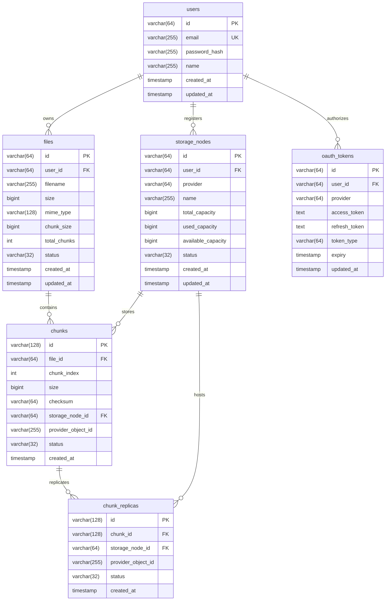
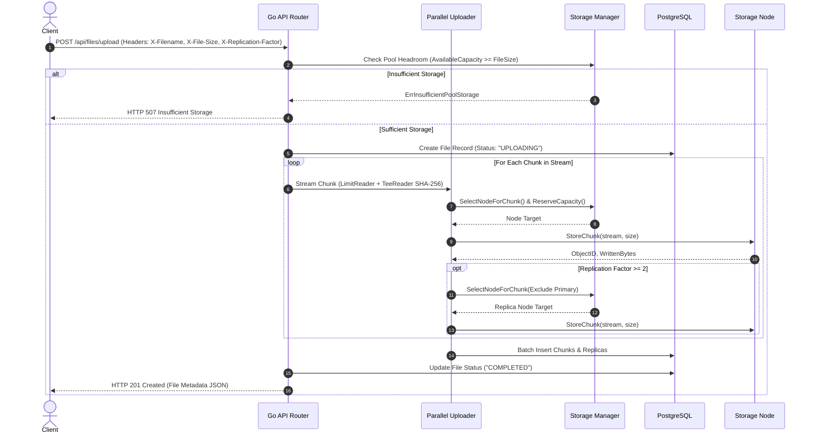
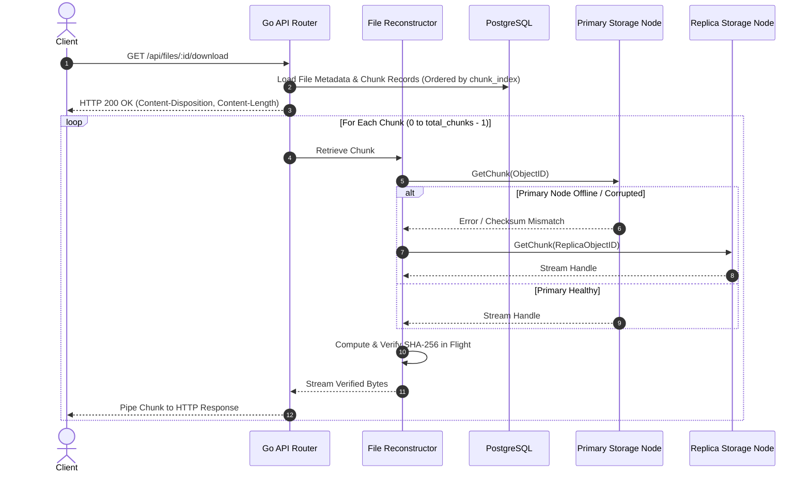
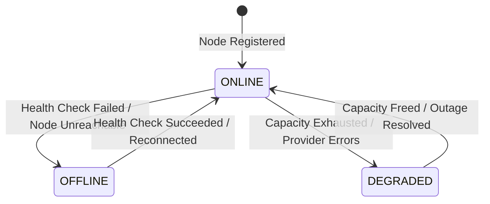

# CloudDump: Distributed Cloud-Storage System

CloudDump is a distributed cloud-storage system that unifies multiple heterogeneous, independent storage nodes and cloud providers into a single, cohesive logical storage pool. It features streaming chunk segmentation, capacity-aware distribution, cryptographic integrity validation (SHA-256), parallel worker pools, node failure handling with chunk replication, background asynchronous jobs via Redis, Google Drive cloud integration, and a Next.js web dashboard.

---

## Table of Contents
1. [Project Overview](#1-project-overview)
2. [Problem Statement](#2-problem-statement)
3. [Architecture](#3-architecture)
4. [System Design](#4-system-design)
5. [Chunking Algorithm](#5-chunking-algorithm)
6. [Storage Allocation Algorithm](#6-storage-allocation-algorithm)
7. [Database Schema](#7-database-schema)
8. [Upload Flow](#8-upload-flow)
9. [Download Flow](#9-download-flow)
10. [Failure Handling & Health Monitoring](#10-failure-handling--health-monitoring)
11. [Chunk Replication](#11-chunk-replication)
12. [Google Drive Integration](#12-google-drive-integration)
13. [API Documentation](#13-api-documentation)
14. [Local Development](#14-local-development)
15. [Docker Setup](#15-docker-setup)
16. [Testing & Verification](#16-testing--verification)
17. [Limitations](#17-limitations)
18. [Future Improvements](#18-future-improvements)
19. [Design Decisions & Tradeoffs](#19-design-decisions--tradeoffs)

---

## 1. Project Overview

CloudDump aggregates fragmented storage capacity from diverse targets—local filesystem partitions, remote storage nodes, and third-party cloud services like Google Drive—into one unified namespace. 

### Key Capabilities
- **Unified Logical Namespace**: Files of any size can be stored across smaller storage nodes seamlessly.
- **Constant Memory Footprint**: Strictly $O(1)$ memory utilization via streaming I/O; never buffers entire files into RAM.
- **Capacity-Aware Distribution**: Dynamically balances chunks according to node headroom rather than naive round-robin or static ratios.
- **Cryptographic Data Integrity**: End-to-end SHA-256 checksum generation and validation for each individual chunk.
- **Controlled Concurrency**: Worker pool upload concurrency with bounded goroutines and thread-safe capacity accounting.
- **Fault Tolerance & Replication**: Automated health checks, degraded asset detection, and replica failover during node outages.
- **Asynchronous Processing**: Redis-backed background worker queue managing replication, health checks, upload finalization, and chunk retries.
- **Multi-Tenant Security**: User authentication, session management via HTTP-only cookies, and strict data isolation.
- **Containerized Development**: Single-command environment orchestration with Docker Compose.

---

## 2. Problem Statement

In modern personal and enterprise computing, storage resources are frequently fragmented across disparate volumes, drives, and cloud tiers:
- **Node A (Local NVMe)**: 10 GB free
- **Node B (External SSD)**: 15 GB free
- **Node C (Google Drive Free Tier)**: 8 GB free
- **Aggregated Logical Capacity**: **33 GB**

A traditional file system or cloud client cannot store a single 20 GB file (e.g. `raw_video.mp4` or a virtual machine image) on any of these targets because no single node possesses 20 GB of contiguous free space.

```
Individual Targets:
[Node A: 10GB] <--- 20GB File? (REJECTED: Insufficient Space)
[Node B: 15GB] <--- 20GB File? (REJECTED: Insufficient Space)
[Node C:  8GB] <--- 20GB File? (REJECTED: Insufficient Space)

CloudDump Logical Pool:
[======================= 33GB Total Logical Pool =======================]
  |-- Chunk 0 (256MB) --> Node B
  |-- Chunk 1 (256MB) --> Node A
  |-- Chunk 2 (256MB) --> Node C
  ... (All 20GB Distributed Dynamically Based on Headroom)
```

**CloudDump solves this** by decomposing files into streaming cryptographic chunks, allocating those chunks across available nodes based on real-time capacity, and reconstructing them on-demand as a single continuous stream during download.

---

## 3. Architecture

CloudDump follows a clean, decoupled layered architecture separating HTTP routing, authentication, business domain logic, storage provider drivers, and background queues.

### Architecture Diagram



---

## 4. System Design

The system is organized into modular packages with explicit responsibilities:

```
clouddump/
├── backend/
│   ├── cmd/server/main.go       # Server entrypoint, configuration, and DI
│   ├── internal/
│   │   ├── api/                 # HTTP handlers, routers, and auth middleware
│   │   ├── auth/                # Session store, JWT tokens, and Google OAuth
│   │   ├── chunks/              # Streaming chunker, reconstructor, and hasher
│   │   ├── database/            # PostgreSQL repository and in-memory test store
│   │   ├── jobs/                # Redis/Memory job queue and background workers
│   │   ├── providers/           # StorageProvider interface (Local, Google Drive)
│   │   ├── storage/             # StorageManager, strategies, and node state
│   │   ├── uploads/             # Resumable session state and chunk tracking
│   │   └── workers/             # Controlled parallel upload worker pool
├── frontend/
│   ├── app/                     # Next.js App Router (Dashboard, Files, Nodes, Upload)
│   ├── components/              # UI components (cards, tables, progress, badges)
│   ├── hooks/                   # React Query hooks (files, nodes, system activity)
│   └── lib/                     # API client and TypeScript definitions
├── storage/                     # Local filesystem mount directories
└── docker-compose.yml           # Multi-service development environment
```

### StorageProvider Abstraction
All storage destinations implement the `StorageProvider` interface, insulating the chunking and allocation engines from underlying protocol details:

```go
type StorageProvider interface {
    StoreChunk(ctx context.Context, chunkID string, r io.Reader, size int64) (objectID string, written int64, err error)
    GetChunk(ctx context.Context, objectID string) (io.ReadCloser, error)
    DeleteChunk(ctx context.Context, objectID string) error
    GetTotalCapacity(ctx context.Context) (int64, error)
    GetAvailableCapacity(ctx context.Context) (int64, error)
    HealthCheck(ctx context.Context) (bool, error)
}
```

---

## 5. Chunking Algorithm

The chunking engine splits incoming byte streams into bounded chunks of fixed maximum size (default: 256 MB, configurable via `CHUNK_SIZE_BYTES`).

### Streaming Mechanics & Constant Memory
- Rather than buffering an entire file or even an entire chunk in memory before computing hashes or sending to disk, CloudDump wraps the input `io.Reader` with an `io.LimitReader` and a dual-writer tee (`io.TeeReader`).
- Data flows directly from the incoming HTTP socket into the destination storage provider while computing the SHA-256 digest in flight.
- Memory consumption remains strictly $O(1)$ regardless of file size.

### Boundary Handling
1. **0-Byte / Empty Files**: Explicitly rejected at pre-flight with `ErrEmptyFile` (HTTP 400 Bad Request).
2. **1-Byte Files**: Processed as exactly 1 chunk of size 1 with valid SHA-256 checksum.
3. **Exact Chunk Size ($N \times \text{chunkSize}$)**: Produces exactly $N$ chunks; no spurious 0-byte trailing chunk is created.
4. **Final Partial Chunk**: If `fileSize % chunkSize != 0`, the final chunk has size equal to the exact remainder, with independent checksum and metadata.

---

## 6. Storage Allocation Algorithm

CloudDump implements a capacity-aware placement engine via the `MaxAvailableStrategy`.

### Allocation Strategy
1. **Headroom Proportionality**: Each chunk is allocated to the active, online storage node currently possessing the highest available capacity.
2. **Pre-flight Capacity Verification**: Before uploading, the engine verifies that total available pool space satisfies $\sum \text{fileBytes}$. If not, it rejects the operation immediately with `ErrInsufficientPoolStorage` (HTTP 507).
3. **Atomic Capacity Reservation**: When a chunk is scheduled, `ReserveCapacity(bytes)` atomically deducts capacity from the selected node. If the chunk write fails or the upload is interrupted, `ReleaseCapacity(bytes)` refunds the node.
4. **Replica Node Exclusion**: When placing a replica chunk, all node IDs currently holding the primary copy or existing replicas are excluded, preventing co-location on the same physical node.

---

## 7. Database Schema

CloudDump uses PostgreSQL for durable relational metadata storage.

### Entity-Relationship Diagram



---

## 8. Upload Flow

CloudDump supports both single-request streaming uploads and multi-request resumable session uploads.

### Streaming Upload Sequence Diagram



### Resumable Upload Flow
1. **Initialize Session**: `POST /api/uploads` creates an upload session with unique `upload_id`.
2. **Chunk Transmission**: `PUT /api/uploads/{id}/chunks/{index}` uploads independent chunks concurrently. Duplicate chunks are acknowledged idempotently.
3. **Interruption & Resumption**: `GET /api/uploads/{id}` exposes completed chunk indices and `next_expected`.
4. **Finalization**: When all chunks are stored, status transitions to `COMPLETED`.

---

## 9. Download Flow

Files are reconstructed as an on-the-fly streaming response.

### Download Sequence Diagram



---

## 10. Failure Handling & Health Monitoring

Storage nodes can experience network partitioning, disk corruption, or provider rate limiting.

### State Transitions


### Fault Detection & Recovery
- **Health Check Worker**: Periodic background worker probes all registered nodes via `node.CheckHealth()`.
- **Degraded File Tracking**: If a node goes offline, any file holding chunks on that node without a surviving replica transitions from `COMPLETED` to `DEGRADED`.
- **Simulated Failure Mechanism**: `POST /api/nodes/:id/simulate-failure` allows developers and administrators to toggle simulated outages for local nodes to verify failover without touching physical hardware.

---

## 11. Chunk Replication

CloudDump provides configurable replication to prevent data loss when nodes fail:
- **Replication Factor**: Configured per file via `X-Replication-Factor` (default: 1, optional: 2+).
- **Physical Node Diversity**: The allocation strategy strictly enforces that replica copies are placed on distinct storage nodes.
- **Failover Resolution**: During file download or reconstruction, if the primary chunk read fails, the reconstructor seamlessly falls back to available replicas.
- **Background Replication Worker**: Scans for under-replicated chunks and allocates missing replicas to healthy candidate nodes idempotently without duplicate chunk creation.

---

## 12. Google Drive Integration

Google Drive is integrated via `GoogleDriveProvider`, treating Google Drive as another heterogeneous `StorageProvider`.

### Technical Implementation
- **OAuth 2.0 Authorization**: User initiates OAuth flow via `GET /api/oauth/google/auth-url` and authorizes with Google; authorization code is exchanged via `POST /api/oauth/google/callback`.
- **Backend-Only Credential Isolation**: OAuth access tokens and refresh tokens are encrypted and stored in PostgreSQL; secrets are never transmitted to the browser.
- **Resumable Drive Uploads**: Implements chunk streaming via Google Drive API's resumable upload protocol (`/upload/drive/v3/files?uploadType=resumable`).
- **Rate Limit & Exponential Backoff**: Automatically catches HTTP 429 and 503 errors and retries with exponential backoff and jitter.

---

## 13. API Documentation

All protected endpoints require an authenticated session cookie or valid session.

### Authentication Endpoints
| Method | Endpoint | Description | Status Code |
| :--- | :--- | :--- | :--- |
| `POST` | `/api/auth/register` | Register new user account | `201 Created` / `409 Conflict` |
| `POST` | `/api/auth/login` | Authenticate and issue HTTP-only cookie | `200 OK` / `401 Unauthorized` |
| `POST` | `/api/auth/logout` | Terminate session and invalidate cookie | `200 OK` |
| `GET` | `/api/auth/me` | Fetch currently authenticated user profile | `200 OK` / `401 Unauthorized` |

### File Endpoints
| Method | Endpoint | Description | Status Code |
| :--- | :--- | :--- | :--- |
| `POST` | `/api/files/upload` | Streaming file upload and chunk distribution | `201 Created` / `507 Insufficient Storage` |
| `GET` | `/api/files` | List all files belonging to authenticated user | `200 OK` |
| `GET` | `/api/files/:id` | Get file metadata, chunk list, and distribution | `200 OK` / `404 Not Found` |
| `GET` | `/api/files/:id/status` | Get real-time file status (`COMPLETED`, `DEGRADED`) | `200 OK` / `404 Not Found` |
| `GET` | `/api/files/:id/download` | Streaming reconstructed file download | `200 OK` / `500 Corrupted` |
| `DELETE`| `/api/files/:id` | Delete file and clean up physical chunks | `200 OK` / `404 Not Found` |

### Resumable Upload Endpoints
| Method | Endpoint | Description | Status Code |
| :--- | :--- | :--- | :--- |
| `POST` | `/api/uploads` | Initialize resumable upload session | `201 Created` |
| `GET` | `/api/uploads` | List active and recent upload sessions | `200 OK` |
| `GET` | `/api/uploads/:id` | Query session progress and completed chunks | `200 OK` / `404 Not Found` |
| `PUT` | `/api/uploads/:id/chunks/:idx`| Upload chunk at specific index | `200 OK` |
| `DELETE`| `/api/uploads/:id` | Cancel session and rollback stored chunks | `200 OK` |

### Storage Node Endpoints
| Method | Endpoint | Description | Status Code |
| :--- | :--- | :--- | :--- |
| `GET` | `/api/nodes` | List registered storage nodes and capacities | `200 OK` |
| `GET` | `/api/nodes/stats` | Aggregated pool capacity and health stats | `200 OK` |
| `POST` | `/api/nodes/reconcile` | Trigger node health reconciliation | `200 OK` |
| `POST` | `/api/nodes/:id/simulate-failure` | Toggle simulated outage on a storage node | `200 OK` |

### Google Drive & OAuth Endpoints
| Method | Endpoint | Description | Status Code |
| :--- | :--- | :--- | :--- |
| `GET` | `/api/oauth/google/auth-url` | Get Google OAuth authorization URL | `200 OK` |
| `POST` | `/api/oauth/google/callback` | Exchange OAuth code for tokens | `200 OK` |
| `GET` | `/api/oauth/google/status` | Check if Google Drive is connected | `200 OK` |
| `POST` | `/api/oauth/google/disconnect` | Disconnect Google Drive account | `200 OK` |
| `POST` | `/api/nodes/google-drive` | Create storage node backed by Google Drive | `201 Created` |

### Background Jobs & System Telemetry
| Method | Endpoint | Description | Status Code |
| :--- | :--- | :--- | :--- |
| `GET` | `/api/jobs` | List recent background jobs and statuses | `200 OK` |
| `GET` | `/api/jobs/:id` | Query details and retry count of a background job | `200 OK` |
| `POST` | `/api/jobs/trigger` | Manually enqueue a background job | `202 Accepted` |
| `GET` | `/api/system/activity` | System telemetry, uptime, recent & failed ops | `200 OK` |

---

## 14. Local Development

### Prerequisites
- **Go**: 1.24+
- **Node.js**: 22+ & npm
- **Docker**: (Optional, for running PostgreSQL and Redis locally)

### 1. Start Infrastructure Dependencies
```bash
# Start PostgreSQL and Redis in background
docker compose up -d postgres redis
```

### 2. Configure Environment Variables
```bash
cp .env.example .env
```

### 3. Run Backend Server
```bash
cd backend
go run cmd/server/main.go
```
The Go API will be live at `http://localhost:8080`.

### 4. Run Frontend Dashboard
```bash
cd frontend
npm install
npm run dev
```
The Next.js dashboard will be live at `http://localhost:3000`.

---

## 15. Docker Setup

To launch the complete development environment with one command:

```bash
docker compose up --build
```

### Docker Services Breakdown
| Service | Image | Internal Port | Host Port | Purpose |
| :--- | :--- | :--- | :--- | :--- |
| **`postgres`** | `postgres:16-alpine` | `5432` | `5432` | Relational database with health check |
| **`redis`** | `redis:7-alpine` | `6379` | `6379` | Background job queue and cache |
| **`backend`** | Multi-stage Go 1.24 | `8080` | `8080` | API server & background workers |
| **`frontend`** | Next.js 16 Standalone | `3000` | `3000` | Web UI dashboard |

---

## 16. Testing & Verification

CloudDump includes a comprehensive test suite with 100% passing tests across all components:

### Run Full Test Suite
```bash
cd backend
# Run all unit, integration, and edge case tests uncached
go test -count=1 ./...
```

### Test Coverage Highlights
- **Chunking Edge Cases** (`internal/chunks/edge_cases_test.go`): 0-byte file rejection, 1-byte file streaming, exact chunk boundaries, trailing partial chunks, insufficient capacity, corrupted chunk detection, context cancellation rollback.
- **Storage Edge Cases** (`internal/storage/edge_cases_test.go`): Missing node handling, all nodes offline, exclusion constraints, capacity reservation and refund accuracy.
- **Provider Tests** (`internal/providers/`): Local filesystem provider, path traversal protection, Google Drive provider mocking, rate limiting and retries.
- **API Integration Tests** (`internal/api/`): Full file upload/download roundtrips, resumable session lifecycle, duplicate request idempotency, cross-tenant isolation, node failure and replica recovery.
- **Background Jobs Tests** (`internal/jobs/jobs_test.go`): Retry backoff, terminal failure tracking, node health check jobs, abandoned upload cleanup, replication jobs.

---

## 17. Limitations

- **Single Storage Pool per User**: Currently, all registered nodes for a user form a single logical pool; custom multi-pool clustering is not yet implemented.
- **Provider Quota & Rate Limits**: Upload speed to cloud providers (e.g. Google Drive) is subject to upstream API rate limits and daily quota restrictions.
- **Local Node Simulation**: Local storage nodes simulate physical disks via subdirectories; total disk usage is bounded by the host filesystem.

---

## 18. Future Improvements

- **Reed-Solomon Erasure Coding**: Implement $(M+N)$ erasure coding (e.g., 8 data chunks + 4 parity chunks) to reduce storage overhead compared to full replication ($2\times$) while retaining high fault tolerance.
- **Content-Addressable Deduplication**: Detect identical chunks across files using global SHA-256 indices to avoid duplicating stored bytes.
- **Additional Storage Providers**: Add native drivers for Amazon S3, Azure Blob Storage, Microsoft OneDrive, and MinIO.
- **Client-Side Zero-Knowledge Encryption**: Support AES-256-GCM client-side encryption so chunks are encrypted before leaving the user's browser.
- **Geo-Distributed Chunk Routing**: Route chunks to nodes based on geographic latency and network bandwidth.

---

## 19. Design Decisions & Tradeoffs

| Decision | Alternative Considered | Rationale & Tradeoff |
| :--- | :--- | :--- |
| **Streaming Chunk I/O ($O(1)$ RAM)** | In-memory buffering (`[]byte`) | Buffering gigabyte-scale files into RAM causes high memory spikes and out-of-memory errors under load. Streaming with `io.LimitReader` and `io.TeeReader` ensures constant low memory, trading off slightly more complex stream orchestration. |
| **Relational Metadata (PostgreSQL)** | Embedded key-value store (SQLite/BoltDB) | Distributed deployments and multiple API instances require centralized ACID consistency for chunk distribution and user isolation. |
| **Dual-Mode Queue (Redis + In-Memory Fallback)** | Hard Redis dependency | Providing `RedisJobQueue` for production alongside `MemoryJobQueue` guarantees that unit tests and offline development run instantly without requiring a live Redis daemon. |
| **HTTP-Only Secure Cookies** | LocalStorage JWT tokens | Storing authentication tokens in `localStorage` exposes them to Cross-Site Scripting (XSS) attacks. HTTP-only cookies prevent JavaScript access while preserving seamless cross-endpoint session authentication. |
| **Distinct Physical Node Replication** | Co-located replication | Allowing replicas on the same node is simpler to allocate but provides zero fault tolerance if that physical drive fails. Enforcing exclusion ensures true hardware resilience. |
| **Synchronous Stream vs Asynchronous Finalization** | Synchronous database lock | Uploading chunks synchronously streams bytes immediately, while final integrity checks and replication jobs are handed off asynchronously to background workers, keeping API responses fast and responsive. |

---

## License

MIT License. Developed for resilient, decentralized cloud storage.
